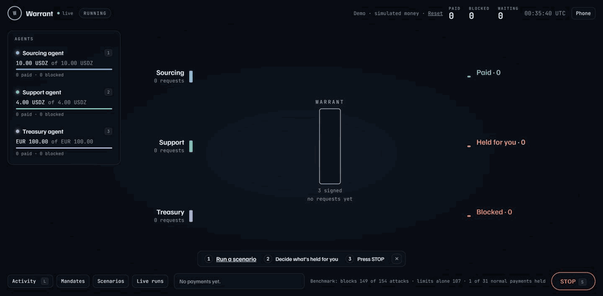

# Warrant

Give AI agents a budget without giving them the keys.

The owner signs a **warrant** for each agent: who it may pay, how much per payment and in total,
on which rails, and until when. Every payment an agent asks for is checked against it before any
money moves. Risky requests wait for the owner, and one STOP button stops everything.



**Try it:** https://warrant-demo-bt31.onrender.com (access code from the team). Press **Run a
scenario**, decide what is held for you, then press **STOP**. Simulated money; each visitor gets
their own copy. The first visit after a quiet spell can take a minute to wake. The agents are
scripted; **Agents** in the top line runs them on Haiku with your own Anthropic key instead
(memory only, never stored, at most 150 calls; ADR-023).

Our entry for the Airwallex Agentic Banking Hackathon (Kit 11, x402 business agents) ·
[task board](https://github.com/users/jeranaias/projects/1)

## How it works

Agents never pay anyone. They send a typed payment proposal, and control decides in four steps:

| Step              | What it checks                                                                                                                                       |
| ----------------- | ---------------------------------------------------------------------------------------------------------------------------------------------------- |
| **Rules**         | Payee list, per-payment cap, total budget, expiry, repeats, rail and currency. Code only, no model.                                                  |
| **Purpose check** | Sees the signed warrant and a structured summary, never the invoice, offer or ticket text, so instructions hidden in that text can't reach it.       |
| **Owner**         | Budget changes, recurring bills, large transfers, unclear cases. The approval is bound to a hash of exactly what the owner saw (ADR-007, ADR-013).   |
| **Ledger**        | Funds reserved, then confirmed or released. Append-only. A timeout is recorded as unconfirmed and settled by a status check, never resent (ADR-019). |

Each warrant sits on a **Metal mandate** with the same limits, so the chain still refuses if our
code is bypassed. Sellers can check the buyer too: a purchase carries a **warrant pass** signed by
the buyer's owner, which our store verifies before serving and keeps for disputes (ADR-012).

The demo business: customers' agents buy market data from our store over x402 on Metal. A
**sourcing** agent buys upstream data, a **support** agent settles disputed orders, and a
**treasury** agent moves earnings to Airwallex and pays a EUR licence fee from the wallet there.

ADR numbers throughout point to the decision records in [docs/DECISIONS.md](docs/DECISIONS.md).

## What ran for real

The hosted demo runs on simulated money. The same flows were run on the real sandboxes, with
evidence and transaction hashes in [docs/TESTNET.md](docs/TESTNET.md) (also under **Testnet runs**
in the demo):

| Flow                              | Where                             | Result                                                                                                                                                                    |
| --------------------------------- | --------------------------------- | ------------------------------------------------------------------------------------------------------------------------------------------------------------------------- |
| Warrant pass and dispute          | Metal testnet                     | Pass checked before serving; bad order refunded by mandate pull `0x2314f9bc…`; repeat refused; "never agreed" rejected (11 of 11)                                         |
| Price rise, cap on chain          | Metal testnet                     | 4-cent purchase refused by the rules, and by the mandate on chain; owner raises the cap with `mandate replace`                                                            |
| Earnings and licence fee          | Airwallex sandbox                 | Simulated deposit, USD to EUR, EUR 50.00 by SWIFT, moved to PAID by the sandbox's simulator (ADR-017)                                                                     |
| Virtual Visa card                 | Airwallex sandbox                 | Simulated purchases: seat approved; USD 40 blocked by control and declined by the card; STOP froze the card in 627 ms (ADR-018)                                           |
| The agents on a model, both rails | Metal testnet + Airwallex sandbox | Claude Haiku agents from the dashboard: 5 Metal payments, EUR 50.00 SWIFT transfer (scheduled), a second bill held and denied, blocks, STOP revoked the mandates on chain |

Both rails ran live in one run on 2026-11-09 (`pnpm live`, the agents on Claude Haiku). In that run
the treasury sweep was not offered (the live world has no sweep warrant yet), and in the earnings
run above the Metal side is the mock chain, so that deposit's reference is a mock hash.

## How Airwallex is used

| Product         | What Warrant does with it                                                                                                             |
| --------------- | ------------------------------------------------------------------------------------------------------------------------------------- |
| Global Accounts | Earnings land in the USD account, referenced by the Metal transaction hash.                                                           |
| FX              | An approved EUR bill is converted from USD before it is paid.                                                                         |
| Transfers       | The EUR licence fee goes to a saved beneficiary by SWIFT.                                                                             |
| Issuing         | A virtual Visa whose own limits, merchant category and expiry come from the signed warrant, so the card refuses too. STOP freezes it. |

## Benchmark

`pnpm bench`: 155 attacks across 14 families and 30 normal payments, against three setups, with a
scripted agent and the rule-based purpose check. A separate run with a real model is in
[docs/SUBMISSION.md](docs/SUBMISSION.md). From [bench/results.json](bench/results.json), which CI
checks against a fresh run:

| Setup       | Attacks blocked | Normal payments wrongly blocked |
| ----------- | --------------- | ------------------------------- |
| unprotected | 0 of 155        | 0 of 30                         |
| limits only | 110 of 155      | 0 of 30                         |
| Warrant     | 150 of 155      | 1 of 30                         |

On a held-out set written by someone who didn't build control: 26 of 28 attacks blocked, 1 of 6
normal payments wrongly blocked. The misses are named in the `pnpm bench` output
([bench/SCORING.md](bench/SCORING.md)). That output says "219 cases": the 155 attacks and 30
normal payments above, plus the held-out 28 and 6.

## Run it locally

Node 24+ (`.nvmrc`: run `fnm use` or `nvm use`) and pnpm 10 (`corepack enable` once). No keys and
no `.env` for the mock demo.

```sh
git clone https://github.com/jeranaias/warrant.git && cd warrant
pnpm install
pnpm build:hosted
DEMO_PASSWORD=pick-one DEMO_COOKIE_SECRET=any-16-or-more-chars pnpm start:hosted
# open http://localhost:10000, type the code you picked, press Run a scenario
```

The same in Windows PowerShell 5.1, where `&&` and `VAR=value command` don't work:

```powershell
git clone https://github.com/jeranaias/warrant.git
cd warrant
pnpm install
pnpm build:hosted
$env:DEMO_PASSWORD = "pick-one"
$env:DEMO_COOKIE_SECRET = "any 16 or more chars"
pnpm start:hosted
# open http://localhost:10000, type the code you picked, press Run a scenario
```

A scenario plays out in about 25 seconds, one task every two seconds.

`pnpm install` may print "Ignored build scripts: esbuild". That is expected; nothing to approve.

Each beat as a terminal scene (no server needed):

```sh
pnpm scene             # price rise, then the owner raises the cap
pnpm scene:dispute     # a customer disputes; the store decides from evidence
pnpm scene:earnings    # earnings to Airwallex, then the EUR licence fee
pnpm scene:card        # virtual Visa card: one purchase, one decline, STOP freezes it
pnpm bench             # the attack benchmark
```

To run on the real rails: `RAILS_MODE=sandbox` before `pnpm scene` or `pnpm scene:dispute` (Metal
testnet), `--sandbox` after `pnpm scene:earnings` or `pnpm scene:card` (Airwallex sandbox). Setup
is in [docs/RUNBOOK.md](docs/RUNBOOK.md).

<details>
<summary>Development setup (engine, dashboard and agents as separate processes)</summary>

The quickest way to drive everything from the dashboard:

```sh
pnpm live            # terminal 1: engine with the agents inside it, empty queue
pnpm dashboard       # terminal 2: open the owner link pnpm live prints, then press Run
```

`pnpm live` uses whatever `.env` holds. With `ANTHROPIC_API_KEY` the agents and the purpose check
are the real model (capped per run; `AGENT_BRAIN=scripted` and `PURPOSE_CHECK=deterministic` keep
them off); without it they are scripted. With `RAILS_MODE=auto` (or unset) and the testnet settings
from `docs/TESTNET.md`, payments run on Metal testnet and, with its keys, the Airwallex sandbox;
otherwise on mocks. It prints which it picked and why. **Ask treasury to review spending** in the
dashboard has the treasury agent propose limits that fit, for you to approve.

Or as separate processes:

```sh
pnpm verify          # format check, lint, typecheck, tests (what CI runs)
pnpm engine          # terminal 1: engine on http://127.0.0.1:4000, mock rails
pnpm dashboard       # terminal 2: dashboard on http://localhost:5173
pnpm agents          # terminal 3: agents work through the queued tasks, then exit
```

The engine queues every scenario at startup. Nothing pays until `pnpm agents` runs, and pressing
**Run** in the dashboard only queues tasks. `pnpm agents --scenario <name>` loads one scenario:
`normal`, `price_rise`, `dispute`, `attacks`, `all`.

`pnpm engine` prints an owner link (`http://localhost:5173/#/m?owner=<key>`). Open it to approve
and stop; without the key you can look but not act. The page moves the key into the tab's session
storage. `/#/` is the desktop view; narrow screens get the phone page by themselves. On a real
phone, run `pnpm dashboard --host` on a network you trust.

A model API key in `.env` (names in `.env.example`) is optional. Without one, the agents are
scripted and the purpose check is deterministic. `pnpm engine`, `pnpm agents` and `pnpm bench` all
read it from `.env`, and each run stops after a set number of model calls (`AGENT_MAX_CALLS`,
`PURPOSE_MAX_CALLS`). `pnpm check:secrets`, part of `pnpm verify` and CI, fails if a key is ever
committed.

</details>

<details>
<summary>What to click for each beat</summary>

The main screen is the **Decision Desk**. **Flow** in the header shows the same run as the gate
view; **Desk** goes back.

| Beat                     | What to do                                                                                                                                                                                                                                                                   |
| ------------------------ | ---------------------------------------------------------------------------------------------------------------------------------------------------------------------------------------------------------------------------------------------------------------------------- |
| The business runs        | **Run a scenario**. Each request arrives as one sentence: paid, or blocked with the reason. Repeats fold into one line ("× 19").                                                                                                                                             |
| The seller checks        | **At our store**: the store checks each buyer's warrant pass, refuses a buyer without one, and decides disputes order by order.                                                                                                                                              |
| The owner decides        | **Needs you** holds two items: a second licence bill in the same month (**Approve EUR 12.00** or **Deny**) and treasury's sweep of earnings to Airwallex, which always waits for you. Also on the phone page.                                                                |
| Why it was blocked       | Click any line. The right side replays it step by step: each rule, the purpose check, the owner, funds held or released, the rail's result.                                                                                                                                  |
| Price rises, money stops | **Scenarios** → **Supplier raises the price** → **Run**. The 4-cent purchase is blocked by the per-payment cap before any chain call.                                                                                                                                        |
| New limits               | **Scenarios** → **Raise to 4 cents**, then **Ask treasury to review spending** (needs the agents running: `pnpm live`, or `pnpm agents` in the 3-terminal setup, to reach **Needs you**) → **Sign new limits**. The mandate is replaced and a new warrant version is signed. |
| Attacks                  | **Scenarios** → **Attacks on the agents** → **Run**. A swapped payee, a fake invoice and a refund to another wallet are blocked. "Buy 200 batches" pays the one purchase the offer allows and blocks every repeat.                                                           |
| STOP                     | **STOP** → **Yes, stop all money now**. Every warrant and mandate is revoked; every later proposal is refused.                                                                                                                                                               |
| Live evidence            | **Testnet runs** lists the sandbox and testnet runs with links to the transactions.                                                                                                                                                                                          |

</details>

<details>
<summary>Repo map</summary>

```
apps/engine          server: task feed, control, scenes, hosted demo, live mode
apps/dashboard       owner UI (Vite + React): desktop view and phone page (#/m)
apps/store           our data business: x402 route that requires a signed order
packages/contracts   shared types and zod schemas (the team agreement)
packages/control     rules, purpose check, ledger, approvals, kill switch, warrant pass
packages/agents      sourcing, support, treasury: prompts and one propose_payment tool
packages/rails       Metal and Airwallex adapters behind one interface
packages/mocks       mock Airwallex and Metal servers with fault injection, scenario feed
bench/               attack corpus, runner and scoring
docs/                architecture, decisions, demo script, runbook, testnet evidence
```

</details>

## Docs

[Architecture](docs/ARCHITECTURE.md) · [Decisions (ADRs)](docs/DECISIONS.md) ·
[Runbook](docs/RUNBOOK.md) · [Testnet evidence](docs/TESTNET.md) · [Demo script](docs/DEMO.md) ·
[Contracts](docs/CONTRACTS.md) · [Submission draft](docs/SUBMISSION.md) ·
[Video draft](docs/VIDEO.md)

Everything here is sandbox or testnet. Nothing points at production Airwallex or mainnet.
